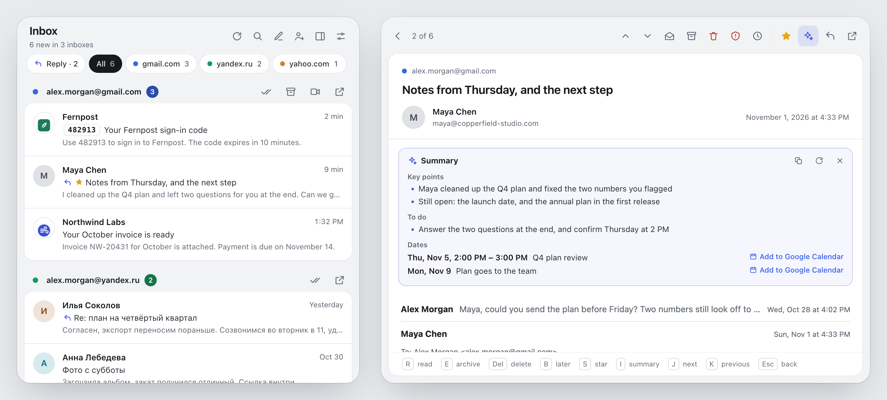
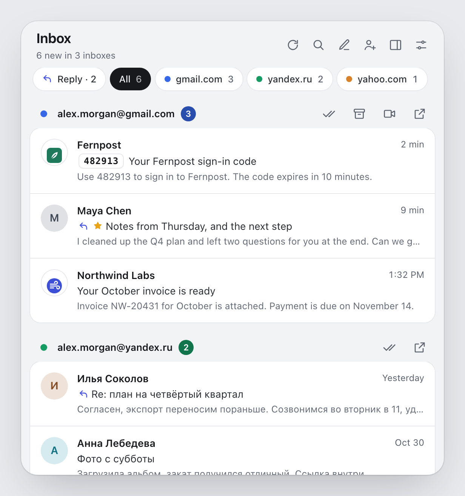
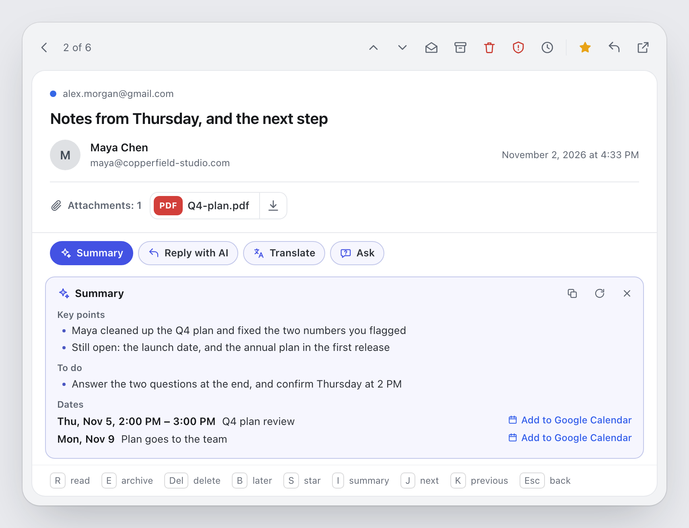
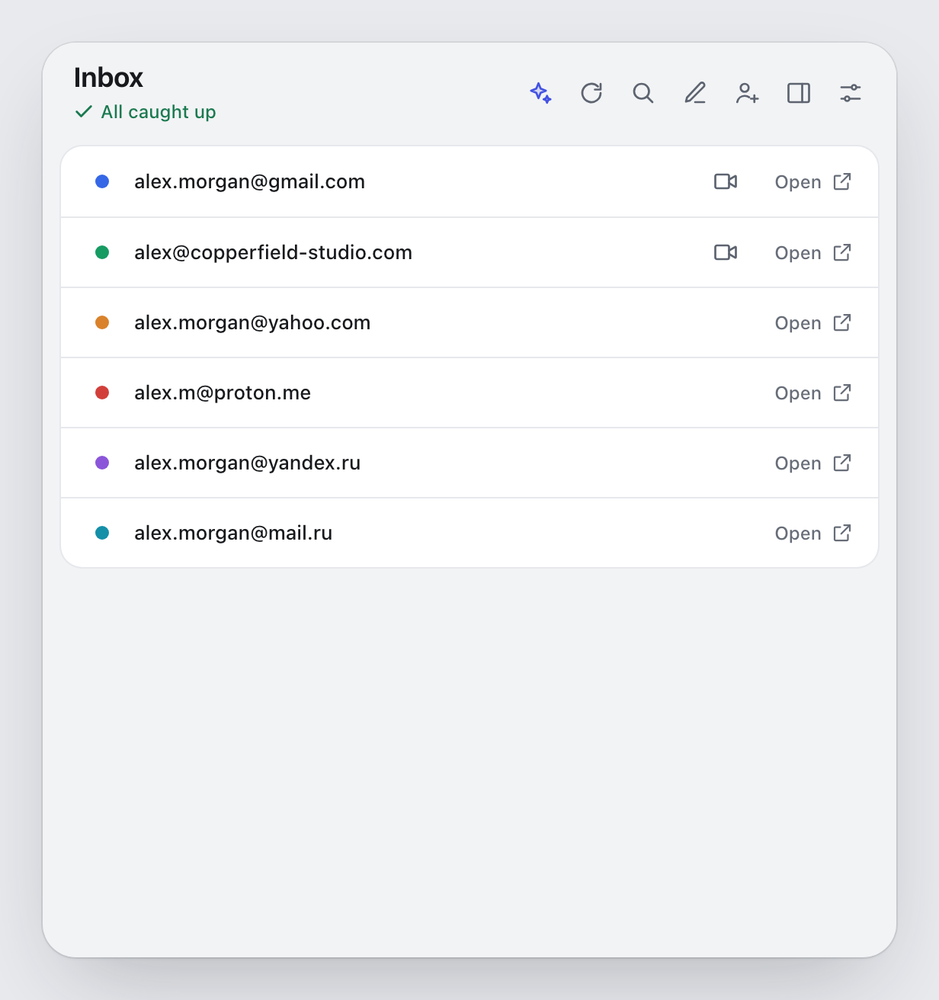
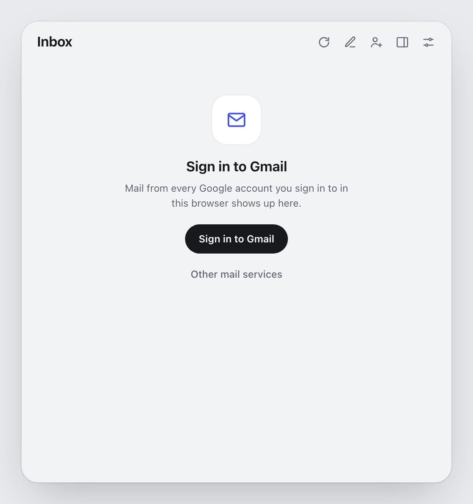
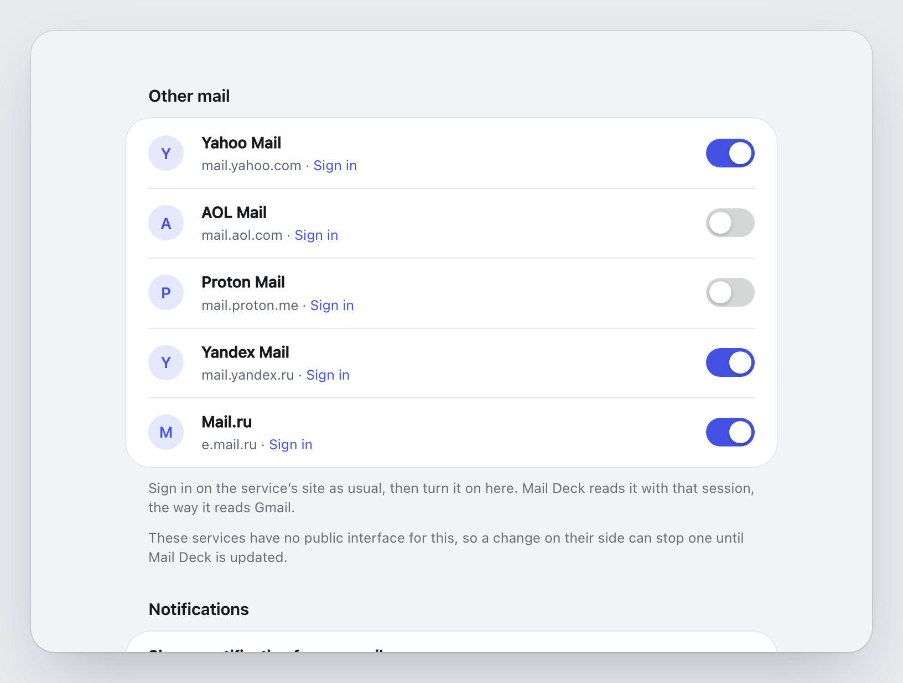

<div align="center">


# Mail Deck

**Every inbox you are signed in to, in one panel.**<br>
Gmail, Yahoo Mail, AOL Mail, Proton Mail, Yandex Mail and Mail.ru. Read, archive and delete mail without opening a tab.

[](https://chromewebstore.google.com/detail/mail-deck/hjlkjemogfgkpbbnogihekjcdmafecff)
[](https://github.com/nord-express/mail-deck/actions/workflows/test.yml)
[](LICENSE)

[Website](https://nord-express.github.io/mail-deck/) · [Features](#features) · [This site](#mail-from-this-site) · [AI assistant](#ai-assistant) · [Other mail](#other-mail-services) · [Screens](#screens) · [Install](#install) · [Privacy](PRIVACY.md) · [Development](#development)

<br>

<picture>
  <source media="(prefers-color-scheme: dark)" srcset="docs/images/hero-dark.png">
  
</picture>

</div>

## Features

- **All your inboxes at once.** Gmail and, once you turn them on, Yahoo Mail, AOL Mail, Proton Mail, Yandex Mail and Mail.ru. Each mailbox gets its own colour and its unread count, and a Google account its own picture too. The chips at the top narrow the list to one inbox.
- **Fast.** Every mailbox is checked at the same time, a Gmail message is fetched while you point at it, and the panel opens again without asking any mail service anything.
- **Read in place.** Click a message to read it in the panel: a Gmail conversation whole, attachments included, and mail from Yahoo, AOL, Yandex and Mail.ru too. Proton mail opens on Proton's site. <kbd>J</kbd> and <kbd>K</kbd> go to the next and previous message without going back to the list.
- **Mail from this site.** Open the panel on a web page and that site's unread mail is at the top, from every inbox, with a fresh sign-in code ready to copy. [More below](#mail-from-this-site).
- **Sign-in codes.** A mail that carries a one-time code shows it as a pill before the subject and in the open message. A click or <kbd>C</kbd> copies the digits; the mail is not opened, marked or moved.
- **AI assistant, if you want one.** A summary of the conversation you are reading, and a chip that gathers the mail waiting for your reply. It runs with Chrome's built-in model on this computer, or with your own OpenAI or Anthropic API key, and is off until you turn it on. [More below](#ai-assistant).
- **Search every Gmail inbox.** One search runs in all your Google accounts at once.
- **Later.** Put a message away until this evening, tomorrow or next week; it comes back with a notification.
- **One key per action.** Mark as read, archive, delete or report spam from the list, from the open message or from a notification. If you like, the next message opens by itself after an action.
- **Labels.** Watch chosen Gmail labels instead of the inbox, set per account, or only Gmail's Primary tab.
- **Your order.** Drag the inboxes into the order you want. Accounts you signed out of stay listed, one click from signing back in.
- **Meet in one click.** Each Gmail mailbox has a button that starts a Google Meet from its account.
- **Notifications and sound.** A desktop notification and an optional sound for new mail. A notification about one inbox has its address as the title, and your own notification text can name it with `[account]`. It can come back every 5 to 60 minutes while the mail stays unread. Mute an inbox while it stays in the panel, set quiet hours and a quiet weekend, or notify only for, or never for, chosen senders and subjects.
- **Your count.** Leave an inbox out of the number on the toolbar icon while it stays in the panel, or have the number count only the mail that came since you last opened the panel.
- **Side panel and keyboard.** Keep the deck open beside the page, or open it with Alt+Shift+M. Text size is yours to set.
- **Backup.** Export your settings to a file, or keep a copy in Chrome sync. An AI key is never in either.
- **Light and dark.** The panel and the settings follow your system theme.
- **Nothing in between.** No servers, no analytics. The extension talks only to Google and to the mail services you turn on, with the session your browser already has, and never sees your password. The AI assistant adds the one provider you connect, if you connect one.

## Mail from this site

Open the panel on a web page, with its toolbar button or <kbd>Alt</kbd>+<kbd>Shift</kbd>+<kbd>M</kbd>, and the unread mail from that site is at the top: the newest three, from every inbox, and "N more" to narrow the list to the site (<kbd>Esc</kbd> widens it again). A sign-in code that came in the last 30 minutes shows big above them, ready to copy with a click or <kbd>C</kbd>. It is for the moment a page says "we sent you a code", for an order you just placed, a password reset, or GitHub's mail while you are on github.com.

A mail is the site's when its sender's domain is the site's (`github.com`, `noreply.github.com`), the same name under another ending (`amazon.de` on `amazon.com`, but not for short or generic names such as `shop` or `app`), or a bulk mail sender whose sender name is the site's. Webmail sites, free mail domains, IP addresses and `chrome://` pages show nothing.

Chrome lets the panel read the tab's address when you open it (the `activeTab` permission, which asks nothing at install). Mail Deck takes the site's domain from it inside the panel; the address is not stored or sent. In the side panel this works for tabs on which you used the toolbar button.

## AI assistant

Off until you turn it on in **Settings → AI**. It does two things:

- **Summary.** In an open message, **Summary** (or <kbd>I</kbd>) puts a card above the conversation: its key points, what it asks of you, and its dates, each with an **Add to Google Calendar** link. It fills in as the answer arrives, can be copied, asked again or hidden, and is kept for the session, so the same mail shows it at once next time. A long conversation is summarized from its newest messages, and the card says so. Summaries come on click (the default) or by themselves for long mail. Proton mail, which opens on Proton's site, has none.
- **Waiting for your reply.** Unread mail from people who expect an answer from you gets a mark, with the reason in its tooltip, and a **Reply** chip, first among the chips, narrows the list to it. Mail from no-reply and other automated addresses or from your own, and mail older than 14 days, are left out. Each answer is kept on this computer for 30 days, so a mail is asked about once.

Choose where it runs:

| Engine | Cost | What leaves this computer |
|---|---|---|
| **On this computer**: Chrome's built-in model | free | nothing: the model runs in Chrome, offline. Chrome downloads it once (a few gigabytes) when you press Download. It needs Chrome 138 or newer and a computer that can run it; Settings → AI says whether yours can. Where it does not support your language yet, it answers in English. |
| **OpenAI**, with your own API key | billed by OpenAI, per use | a summary sends that conversation's text and subject; Waiting for your reply sends the sender, subject and preview of unread mail, up to 20 at a time. Straight from your browser to `api.openai.com`. |
| **Anthropic**, with your own API key | billed by Anthropic, per use | the same, to `api.anthropic.com`. |

A ChatGPT Plus or Claude Pro subscription does not include API access: a key comes from [platform.openai.com](https://platform.openai.com/api-keys) or [console.anthropic.com](https://console.anthropic.com/settings/keys) and is billed separately. **Connect** asks Chrome for that provider's site alone, checks the key and lists its models, the recommended ones first. **Disconnect** forgets the key and gives the access back. The key stays in this browser's extension storage: never in a backup, in Chrome sync or in diagnostics. There are no servers of ours in between, and the answer is shown as plain text. The details are in the [privacy policy](PRIVACY.md#ai-assistant).

## Other mail services

Yahoo Mail, AOL Mail, Proton Mail, Yandex Mail and Mail.ru work the way Gmail does: through the session the browser already has on the service's site. No password, no app password, no OAuth, no servers of ours.

1. Sign in on the service's site as usual.
2. In Mail Deck's settings, under **Other mail**, turn the service on. Chrome asks you to allow that service's sites.
3. Its mailboxes join the panel, the badge and the notifications.

Turning a service off removes the permission again. A service that fails for a moment keeps showing its last answer for up to 30 minutes.

| Service | Sites it asks for | Read in the panel | Archive |
|---|---|---|---|
| Yahoo Mail | `mail.yahoo.com` | yes | yes |
| AOL Mail | `mail.aol.com` | yes | yes |
| Proton Mail | `mail.proton.me` | no, opens on Proton's site: the mail is end-to-end encrypted | yes |
| Yandex Mail | `api.passport.yandex.ru`, `mail.yandex.ru`, `mail.360.yandex.ru` | yes | no |
| Mail.ru | `portal.mail.ru`, `e.mail.ru` | yes | no |

Mark as read, delete, report spam, Undo and Remind me later work for all of them. Search, stars, Google Meet, labels and the Primary tab are Gmail's, and only Gmail's mail is fetched ahead while you point at it. Proton Mail, Yandex Mail and Mail.ru show every account signed in on their site; Yahoo Mail and AOL Mail show the one their site has open.

None of these services has a public interface for this, so Mail Deck follows their own web apps, and a change on their side can stop one until Mail Deck is updated. What each one is asked, and why, is in the [privacy policy](PRIVACY.md).

## Screens

<table>
  <tr>
    <td width="50%" align="center">
      <picture>
        <source media="(prefers-color-scheme: dark)" srcset="docs/images/inbox-dark.png">
        
      </picture>
      <br><b>Inbox</b><br><sub>One card per mailbox, actions on hover</sub>
    </td>
    <td width="50%" align="center">
      <picture>
        <source media="(prefers-color-scheme: dark)" srcset="docs/images/read-dark.png">
        
      </picture>
      <br><b>Message</b><br><sub>The full text, with every action one click or key away</sub>
    </td>
  </tr>
  <tr>
    <td width="50%" align="center">
      <picture>
        <source media="(prefers-color-scheme: dark)" srcset="docs/images/empty-dark.png">
        
      </picture>
      <br><b>All caught up</b><br><sub>Nothing unread, with a link to every inbox</sub>
    </td>
    <td width="50%" align="center">
      <picture>
        <source media="(prefers-color-scheme: dark)" srcset="docs/images/signin-dark.png">
        
      </picture>
      <br><b>First run</b><br><sub>Sign in to Google and your mail shows up; other mail services are one click away</sub>
    </td>
  </tr>
  <tr>
    <td colspan="2" align="center">
      <picture>
        <source media="(prefers-color-scheme: dark)" srcset="docs/images/settings-dark.png">
        
      </picture>
      <br><b>Settings</b><br><sub>Other mail: one switch per service, and Chrome asks for that service's sites alone</sub>
    </td>
  </tr>
</table>

### Keys

| In the list | In a message | Does |
|---|---|---|
| <kbd>J</kbd> / <kbd>K</kbd> or arrows | <kbd>J</kbd> / <kbd>K</kbd> | Next / previous message |
| <kbd>Enter</kbd> | | Open the message |
| <kbd>R</kbd> | <kbd>R</kbd> | Mark as read |
| <kbd>E</kbd> | <kbd>E</kbd> | Archive |
| <kbd>Delete</kbd> or <kbd>Backspace</kbd> | <kbd>Delete</kbd> or <kbd>Backspace</kbd> | Delete |
| <kbd>!</kbd> | <kbd>!</kbd> | Report spam |
| <kbd>O</kbd> | <kbd>O</kbd> | Open in the web app |
| <kbd>B</kbd> | <kbd>B</kbd> | Remind me later |
| <kbd>C</kbd> | <kbd>C</kbd> | Copy the one-time code: the open message's, the focused line's, or else the site's at the top |
| | <kbd>S</kbd> | Star (Gmail) |
| | <kbd>I</kbd> | Show or hide the summary (AI assistant) |
| <kbd>Z</kbd> | <kbd>Z</kbd> | Undo the last action |
| <kbd>/</kbd> | | Search every Gmail inbox |
| <kbd>Alt</kbd>+<kbd>↑</kbd> / <kbd>↓</kbd> | | Move the inbox of the focused line up or down |
| <kbd>Esc</kbd> | <kbd>Esc</kbd> | Back to the list from a message; out of the search, the site's mail or the Reply chip |

The keys go by position, so they work with any keyboard layout. In a message, the arrows scroll it. Archive is not there for Yandex Mail and Mail.ru.

## Install

**From the [Chrome Web Store](https://chromewebstore.google.com/detail/mail-deck/hjlkjemogfgkpbbnogihekjcdmafecff).**

**From source** (Chrome, Brave, Edge, any Chromium browser):

1. Download this repository and unzip it.
2. Open `chrome://extensions` and turn on **Developer mode**.
3. Click **Load unpacked** and pick the `extension` folder.
4. Sign in to Gmail in the same browser, or turn on another mail service in the settings under **Other mail**. The envelope on the toolbar shows your unread count.

## Development

```
extension/            the extension (load this folder unpacked)
  manifest.json
  core/               background: checking feeds, badge, notifications, actions
  core/services/      the other mail services, one file each: Yahoo, AOL, Proton, Yandex, Mail.ru
  core/services.js    runs them: their permissions, the Origin rules, their mailboxes in the check
  data/panel/         the toolbar panel
  data/ai/ai.js       the AI assistant: the three engines, summaries, waiting for your reply
  data/settings/      the settings page
  _locales/           translations
store/                Chrome Web Store listing text and images
tools/build-icons.sh  renders the icons from tools/icons.html
tools/package.sh      zips the extension for the store into dist/
tools/publish.py      uploads that zip to the Chrome Web Store and submits it for review
tools/test/run.sh     runs the tests: scripts, locales, settings, the background check, the mail services, the AI module, the panel in headless Chrome
tools/test/services/  one test per mail service, against a fake of that service
docs/images/          the pictures in this README
```

Mail comes from Gmail's Atom feed of each signed-in account, the full text from the message's print view, and actions go to `mail.google.com` the way the Gmail page sends them.

Each of the other services is one file in `extension/core/services/` with the same shape: its `name`, the sites it needs (`origins`), its `signIn` and `compose` links, what it `can` do (`archive`, `spam`, `body`), and `collect`, `action` and `body`, which talk to the service the way its web app does. `extension/core/services.js` checks only the services turned on and granted, sets the Origin rules and hands their mailboxes to the check, so the panel takes them like Gmail's. `tools/test/services.test.js` tests that runner, and `tools/test/services/` has one test per service against a fake of it, so no account is needed.

The AI assistant is `extension/data/ai/ai.js` (`self.AI`), loaded by the panel and the settings page. It calls Chrome's Prompt API or each provider's HTTP API with `fetch` and streaming, with no SDK, and turns every failure into a short `AIError`. `tools/test/ai.test.js` tests it against mocked streams, with no network.

There is no build step: edit a file, then reload the extension on `chrome://extensions`.

Package for the store:

```sh
tools/package.sh      # dist/mail-deck-<version>.zip
```

## License

[Mozilla Public License 1.1](LICENSE). Mail Deck grew out of Notifier for Gmail by InBasic; see [NOTICE.md](extension/NOTICE.md). The mail services in `extension/core/services/` adapt code from other open-source projects under MPL-2.0, MIT and Apache-2.0; each file names its sources and their licence at the top.

Mail Deck is not made by or affiliated with Google, Yahoo, AOL, Proton, Yandex, VK, OpenAI or Anthropic. Gmail is a trademark of Google LLC; the other names belong to their owners.
